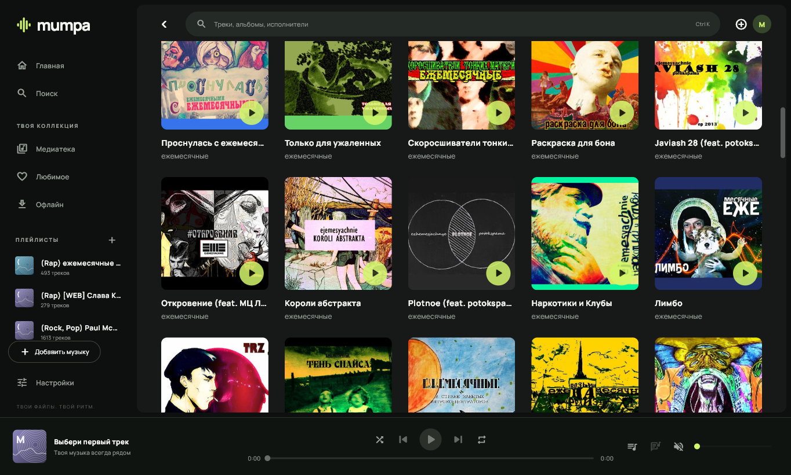
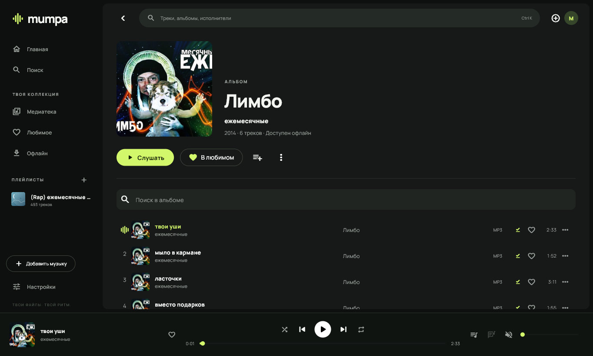

  

<h1 align="center">Mumpa</h1>

  Музыкальный плеер для Windows и Android. 
  Локальные альбомы, торрент-стриминг и офлайн — в одной медиатеке.

  
  
  
  

  <a href="https://github.com/d0rj/mumpa/releases/latest"><strong>Скачать</strong></a> ·
  <a href="#возможности">Возможности</a> ·
  <a href="#быстрый-старт">Быстрый старт</a> ·
  <a href="docs/USAGE.md">Руководство</a>

## Возможности

- **Вся музыка в одном месте.** Добавляй свои папки и аудиофайлы, открывай magnet-ссылки и `.torrent`. Альбомы, исполнители, любимое и плейлисты всегда под рукой.
- **Поиск без настройки.** Встроенный каталог Knaben + RuTor доступен сразу, без аккаунта и отдельного сервера. Можно подключить свои источники через Jackett/Prowlarr или RuTracker.
- **Слушай сразу.** Запускай треки из раздач, не дожидаясь полной загрузки. Торрент-движок уже встроен; следующие песни можно готовить заранее.
- **Забирай музыку с собой.** Сохраняй отдельные треки и целые альбомы для офлайн. Есть автосохранение во время прослушивания, очередь загрузок и пауза.
- **Открывай новое.** Изучай дискографии и похожих исполнителей. Включи радио после плейлиста, чтобы продолжить слушать музыку в том же духе.
- **Собирай свою очередь.** Перетаскивай треки в очереди и плейлистах, выбирай версии одной песни, пользуйся повтором, перемешиванием и таймером сна.
- **Переноси профиль.** В настройках можно выгрузить избранное, плейлисты, историю и настройки в JSON и импортировать на другом устройстве.
- **Настраивай звук.** Отключаемый шестиполосный эквалайзер с пресетами, плавные переходы 1–12 секунд, выравнивание громкости и монозвук. Русский и английский интерфейс переключаются в настройках.

**На компьютере** — тёмный интерфейс с обложками, трей, горячие клавиши и медиакнопки.

**На телефоне** — компактная навигация, фоновое воспроизведение и управление из уведомления.

Поддерживаются **MP3, FLAC, M4A/AAC, OGG/Opus, WAV, ALAC** и другие аудиоформаты.
Mumpa читает теги, обложки и встроенные тексты песен; поддержка конкретного файла зависит от кодека.

Ещё один взгляд: альбом и плеер

## Скачать и установить

Готовые сборки находятся в [**GitHub Releases → последний выпуск**](https://github.com/d0rj/mumpa/releases/latest), в разделе **Assets**.

| Платформа | Что скачать | Как установить |
| --- | --- | --- |
| **Windows x64** | `Mumpa-…-windows-x64.zip` | Распакуй весь архив и запусти `Mumpa/Install Mumpa.cmd`. Приложение появится в меню «Пуск». |
| **Android 7.0+** | `Mumpa-…-android-arm64.apk` | Открой APK на телефоне и разреши установку из выбранного источника, если Android попросит. |

Для переносного запуска Windows открой `Mumpa/mumpa.exe` из распакованной папки.
Для Android также доступны APK под **ARMv7** и **x86_64**; ARM64 подходит большинству современных телефонов.
Обновления можно проверять и скачивать в **Настройки → О приложении**.

## Быстрый старт

1. **Выбери музыку.** Найди исполнителя или альбом в общем поиске — каталог работает в режиме «Автоматически».
2. **Нажми «Слушать».** Открой альбом или коллекцию и включи нужный трек.
3. **Сохрани любимое.** Нажми сердечко, собери плейлист или скачай альбом для офлайн.

Свои файлы можно добавить кнопкой **«Добавить музыку»**: выбери папку, аудиофайл, magnet-ссылку или `.torrent`.
Для торрент-стриминга нужны доступные пиры; локальная и полностью скачанная музыка играет без сети.

## Подробнее

| Документ | Что внутри |
| --- | --- |
| [Руководство](docs/USAGE.md) | Плеер, поиск, плейлисты, источники и офлайн |
| [Первый запуск и данные](docs/FIRST_RUN.md) | Готовый каталог, хранение и восстановление медиатеки |
| [Установка и обновления](docs/APP_UPDATES.md) | Windows, переносной запуск и обновление APK |
| [Сборка из исходников](docs/DEVELOPMENT.md) | Подготовка окружения, сборка и тесты |
| [Архитектура](docs/ARCHITECTURE.md) · [CI](docs/CI.md) · [Проверки](docs/VALIDATION.md) | Устройство проекта и техническая документация |

Нашёл ошибку или есть идея? [Создай issue](https://github.com/d0rj/mumpa/issues).

---

Mumpa написана на **Flutter** и распространяется под [**GPL-3.0**](LICENSE).
[Лицензии компонентов и сторонних данных](THIRD_PARTY_NOTICES.md).
